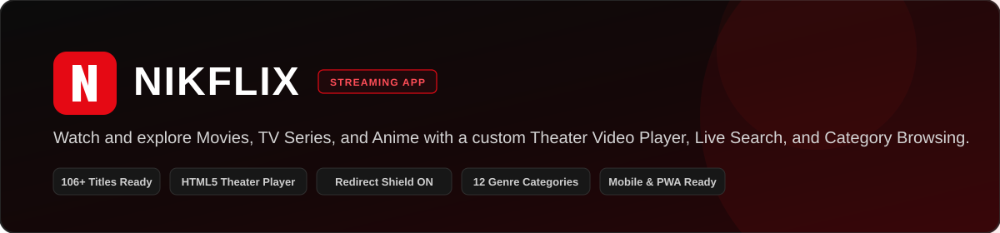
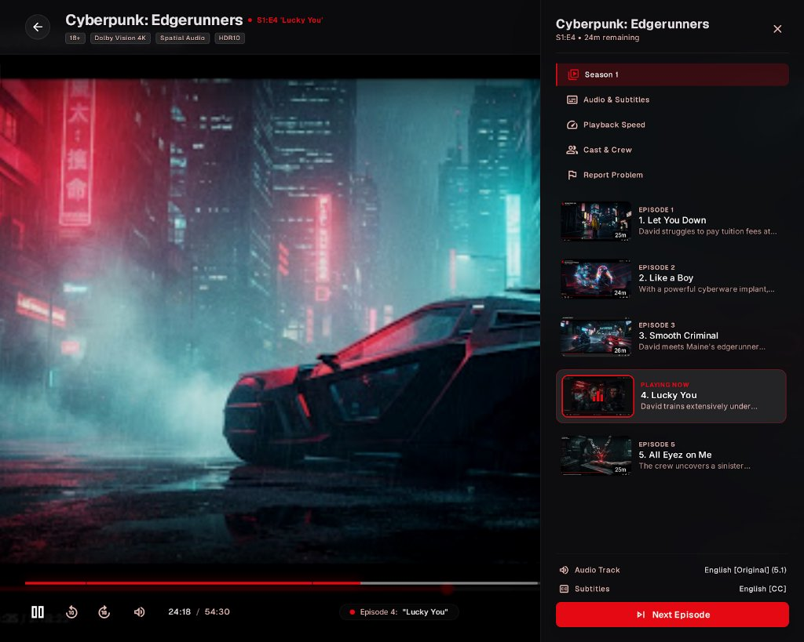
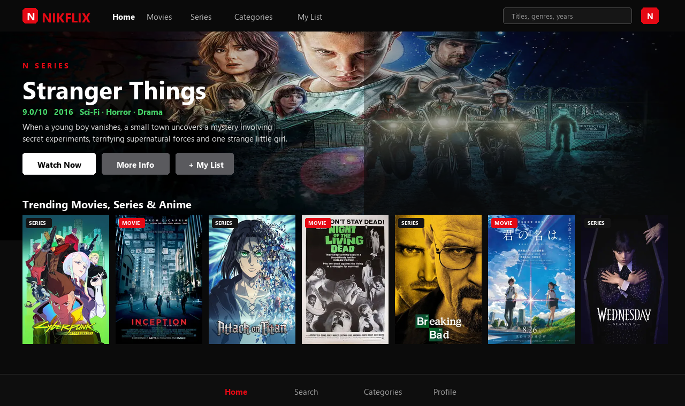
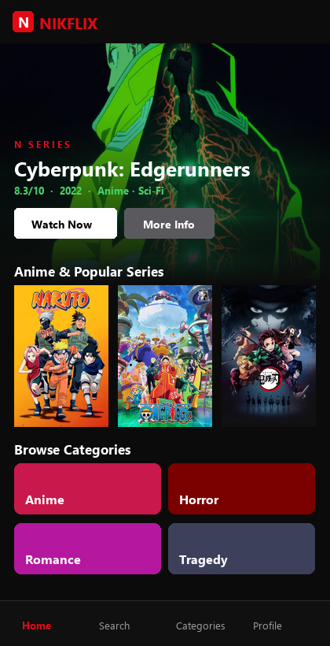

<div align="center">

<a href="https://nikhilmeshram2006.github.io/Nikflix/">
  
</a>

<br>

<p align="center">
  <a href="https://nikhilmeshram2006.github.io/Nikflix/">
    
  </a>
  &nbsp;&nbsp;
  <a href="https://nikhilmeshram2006.github.io/Nikflix/watch.html?id=s-cyberpunk-edgerunners&s=1&e=4">
    
  </a>
  &nbsp;&nbsp;
  <a href="https://nikhilmeshram2006.github.io/Nikflix/categories.html">
    
  </a>
</p>

<p align="center">
  <a href="https://nikhilmeshram2006.github.io/Nikflix/"><strong>https://nikhilmeshram2006.github.io/Nikflix/</strong></a>
</p>

<p align="center">
  
  
  
  
</p>

</div>

---

## Overview

**Nikflix** is a responsive, Netflix-inspired streaming web application built with vanilla HTML5, CSS3, and JavaScript. It combines a fast local catalog of **106+ movies, TV series, and anime** (with locally optimized WebP posters and backdrops) with live **TVmaze** and **Internet Archive** integrations, a custom **Split-Stage Theater Video Player**, and a mobile-first bottom navigation bar.

---

## Screenshots

### 1. Custom HTML5 Theater Video Player & Episode Drawer (`watch.html`)
<p align="center">
  <a href="https://nikhilmeshram2006.github.io/Nikflix/watch.html?id=s-cyberpunk-edgerunners&s=1&e=4">
    
  </a>
</p>

### 2. Desktop Home & Mobile Experience (`index.html`)
<table>
  <tr>
    <td width="68%" valign="top">
      <p align="center"><strong>Desktop Home Screen</strong></p>
      <a href="https://nikhilmeshram2006.github.io/Nikflix/">
        
      </a>
    </td>
    <td width="32%" valign="top">
      <p align="center"><strong>Mobile &amp; Bottom Bar View</strong></p>
      <a href="https://nikhilmeshram2006.github.io/Nikflix/">
        
      </a>
    </td>
  </tr>
</table>

---

## Key Features

- **106+ Bundled Movies, Series & Anime**: Pre-indexed with locally compressed `.webp` posters and backdrops, IMDb IDs, ratings, synopses, and video streams so the catalog loads instantaneously with zero broken images.
- **Split-Stage Theater Player (`watch.html`)**:
  - Custom red timeline scrubber, Play/Pause, `-10s` / `+10s` skip buttons, volume slider, playback speed selector (`0.5x` to `2x`), Picture-in-Picture (`PiP`), and Fullscreen.
  - Collapsible right-hand **Episodes & Settings Drawer** featuring season switching, episode thumbnails, `PLAYING NOW` indicator, audio/subtitle track toggles, and a **Next Episode** button.
  - **8 Stream Sources + Redirect Shield**: Switch between the native **HTML5 Player**, **YouTube HD** (with custom controls), **Internet Archive** streams, **5 sandboxed multi-servers** (with popup and redirect blocking enabled), **Custom Video URL**, or **Local Video File** playback.
  - **Auto-Saved Playback Progress**: Automatically remembers where you left off on each movie or episode.
- **Instant & Live Search (`search.html`)**:
  - Searches the local catalog by title, genre, or release year as you type.
  - Simultaneously fetches live TV series from the **TVmaze API** and full-length streams from the **Internet Archive API**.
- **12 Genre Categories (`categories.html`)**:
  - Browse **Anime**, **Horror**, **Romance**, **Tragedy**, **Action**, **Comedy**, **Sci-Fi**, **Thriller**, **Crime**, **Drama**, **Fantasy**, and **Family**, filterable by **All**, **Movies**, or **Series**.
- **Persistent Bottom Navigation & Mobile Drawer**:
  - Fixed bottom bar for **Home**, **Search**, **Categories**, and **Profile** across mobile and desktop viewports, with zero horizontal overflow.
- **Personal Profile & My List (`profile.html`)**:
  - Customize your profile name, avatar color, and playback preferences, and manage **My List** and **Recently Viewed** history via `localStorage`.

---

## How to Use

### 1. Watch Online (No Installation Required)
Open the live deployment on any smartphone, tablet, or computer:
- **Live URL**: [https://nikhilmeshram2006.github.io/Nikflix/](https://nikhilmeshram2006.github.io/Nikflix/)

### 2. Install as an App on Your Smartphone (PWA)
Nikflix includes a Web App Manifest (`site.webmanifest`) and touch icons so it can be installed on your home screen:
- **Android (Chrome)**: Open the live URL, tap the browser menu (`⋮`), and select **Add to Home screen** or **Install app**.
- **iOS (Safari)**: Open the live URL, tap **Share**, and select **Add to Home Screen**.

### 3. Using the Video Player
1. Click **Watch Now** on any featured banner, title page, or episode card.
2. Use the source pills in the top-right bar (**HTML5 Player**, **YouTube HD**, **Archive Stream**, **Server 1–5**, or **Local File**) or click **Next Source** in the bottom bar if you want to switch streams.
3. Click **Local File** in the top bar to play any `.mp4`, `.mkv`, or `.webm` video file stored on your device inside the Nikflix theater interface.
4. For TV series and anime, use the right-hand drawer to switch **Seasons**, jump to any **Episode**, or adjust **Playback Speed** and **Audio & Subtitles**.

### 4. Player Keyboard Shortcuts

| Key | Action |
| :--- | :--- |
| `Space` or `K` | Play / Pause video |
| `Left Arrow` or `J` | Rewind 10 seconds |
| `Right Arrow` or `L` | Fast-forward 10 seconds |
| `M` | Mute / Unmute audio |
| `F` | Toggle Fullscreen |

---

## Run Locally on Your Computer

### Option A: One-Click Windows Launcher
Double-click **`start-nikflix.bat`** in the project folder. It starts a local server on port `8080` and opens `http://localhost:8080/` in your default browser.

### Option B: Command Line (PowerShell / Terminal)
```powershell
git clone https://github.com/nikhilmeshram2006/Nikflix.git
cd Nikflix
python -m http.server 8080
```
Then open **http://localhost:8080/** in your browser.

---

## Project Structure

```text
Nikflix/
├── index.html              # Home page with hero banner & horizontal category rows
├── watch.html              # Split-stage HTML5 theater player & episode drawer
├── title.html              # Movie/series details, trailer link, episodes & similar titles
├── search.html             # Instant catalog search + live TVmaze & Archive.org search
├── categories.html         # 12 genre tiles & Movie/Series filter chips
├── profile.html            # User profile editor, stats, My List & viewing history
├── help.html               # FAQ, clickable phone/email cards & validated contact form
├── privacy.html            # Privacy policy
├── terms.html              # Terms of use
├── 404.html                # Custom 404 page
├── css/
│   └── style.css           # Mobile-first responsive stylesheet & theater player UI
├── js/
│   ├── app.js              # Shared navigation, search engine, storage & UI components
│   └── data.js             # Pre-built catalog (106+ titles, IMDb/YouTube IDs & streams)
├── assets/
│   ├── posters/            # Compressed WebP movie & series posters (342px)
│   ├── backdrops/          # Compressed WebP widescreen hero backdrops (1280px)
│   └── preview/            # README screenshots & SVG button assets
└── tools/
    ├── build_catalog.py    # Fetches & compresses catalog data from Wikipedia & TVmaze
    ├── enrich_catalog.py   # Adds IMDb IDs & full-length Archive.org MP4 streams
    ├── add_streams.py      # Populates official YouTube video IDs across the catalog
    └── check_links.py      # Automated QA checker for links, images & metadata
```

---

## License & Attribution

This project is an educational, non-commercial portfolio clone and is not affiliated with or endorsed by Netflix, Inc.
- Series metadata and episode listings provided by [TVmaze](https://www.tvmaze.com/) (CC BY-SA).
- Movie synopses provided by [Wikipedia](https://www.wikipedia.org/) (CC BY-SA).
- Public-domain and open-source video streams hosted by the [Internet Archive](https://archive.org/).
